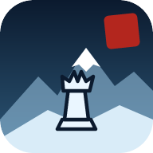

<p align="center"></p>

<h1 align="center">Chess of the Nine Peaks</h1>

<p align="center">
  Offline-first chess with a murim / manhwa soul — duel across seven realms, from frozen peaks to an obsidian underworld.<br>
  <a href="https://sarin-jacob.github.io/chess/"><b>▶ Play now</b></a>
</p>

---

## Features

- **Seven realms.** Every match is played in a living scene with its own board, palette and weather:

  | Realm | | Season | Weather |
  |---|---|---|---|
  | Frozen Peak Sect | 冰峰 *Ice Peak* | Winter | snow |
  | Maple Grove Pavilion | 枫林 *Maple Forest* | Autumn | falling leaves |
  | Molten Flame Valley | 炎谷 *Flame Valley* | Summer | rising embers |
  | Spring Blossom Court | 春庭 *Spring Courtyard* | Spring | petals |
  | Sunken Jade Temple | 沉玉殿 *Sunken Jade Hall* | Rains | bubbles |
  | Obsidian Underworld | 冥渊 *Abyss of the Dead* | Night | spirit wisps |
  | White Salt Plateau | 白盐原 *White Salt Plain* | Day | salt glints |

  By default the realm is **random every match** ("Wandering Fate"); pick one in *Realms* to stay there.
  Every Chinese glyph has an English label or tooltip, and there's a full glossary in *Settings*.
- **Three ways to play**
  - **Vs the Sect** — built-in engine in a Web Worker, eight ranks from *Outer Disciple* to *Martial Sovereign*.
  - **Same device** — pass-and-play; the board can turn to face whoever moves (on by default on phones, off on desktop).
  - **LAN duel** — two browsers talk directly over WebRTC. No server, no account: share an invite (QR / link / code), paste back the reply, play. Draw offers, resignation and rematches (colours swap, new realm) included.
- **House rules and clocks.** Before a match pick a time control (untimed, bullet to 30 min, with increments) and whether hints and takebacks are allowed. Clocks are synced in LAN duels; in LAN each player always sits at the bottom of their own board.
- **Optional 3D board.** Each realm carves its own set — ice and glacier glass, maple and walnut, temple gold and lava-veined basalt, porcelain and red lacquer, jade and bronze, moon-silver and obsidian, rose salt and sandstone — with fixed Player / Overhead / Low camera angles (`v` to switch) and a full-screen view.
- **Your archive, in your browser.** Every game is saved to IndexedDB as you play: resume unfinished matches, review any game move by move, see your win/loss record and which realms you've conquered, import/export PGN.
- **Feels good to play.** Tap-to-move or drag-and-drop, legal-move hints, promotion picker, synthesized wood-knock and temple-bell sounds, haptics on supported phones, keyboard review (← → ↑ ↓, `f` to flip).
- **Installable & offline.** PWA manifest + service worker; once loaded it works without a network.
- **Works in Firefox and Chromium** (desktop and mobile).

## Develop

```bash
npm install
npm run dev      # http://localhost:5173 (also exposed on your LAN for testing duels between devices)
npm run check    # svelte-check + tsc
npm run build    # static site in dist/
```

Stack: [Svelte 5](https://svelte.dev) + TypeScript + [Vite](https://vite.dev), [chess.js](https://github.com/jhlywa/chess.js) for rules. No backend.

```
src/
  App.svelte            layout, player bars, start gate, result dialog
  lib/Board.svelte      board UI (pointer/touch, drag, promotion, animation)
  lib/Board3D.svelte    3D board (three.js, loaded only when switched on)
  lib/three/            3D scene, piece geometry and per-realm materials
  lib/Scenery.svelte    sky, mountains and canvas weather per realm
  lib/game.svelte.ts    game state, rules and clocks, AI turns, persistence, LAN protocol
  lib/engine.worker.ts  alpha-beta engine (runs off the main thread)
  lib/lan.ts            WebRTC data channel + compressed manual signalling
  lib/db.ts             IndexedDB archive
  lib/realms.ts         realm palettes, particles and glossary
```

### Branches & releases

Work happens on `dev`. Merging a good release into `main` triggers CI, which type-checks, builds and deploys to GitHub Pages.

### LAN notes

Both devices should be on the same network. With no internet, browsers connect using local candidates only; the
optional public STUN helper (Settings) can help when local discovery is blocked. Invite codes are single-use.

## Roadmap

- Stockfish (WASM) as an optional stronger opponent
- Ambient music per realm

## Credits

- Piece set: *cburnett* by Colin M.L. Burnett (BSD / GPL / GFDL), via Wikimedia Commons.
- Fonts: [Cinzel](https://fonts.google.com/specimen/Cinzel) and [Ma Shan Zheng](https://fonts.google.com/specimen/Ma+Shan+Zheng) (SIL OFL); the latter is subset to the glyphs used (`scripts/subset-font.py`).

## License

[MIT](LICENSE)
